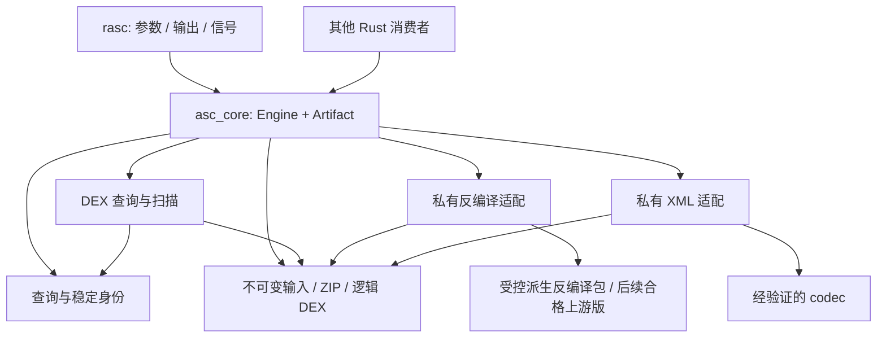

## Context

核心对象是“一个不可变输入里的分析事实”。APK/DEX/AXML 是输入格式，CLI 是交付这些事实的一种方式；二者不应定义分析结果的身份或错误。

当前可复用资产包括 checked bytes reader、DEX table scanner、opcode/filter/prefix、041 view、ZIP discovery 与 manifest renderer。`query.rs` 已解除 scanner 对 clap 的直接依赖，但 `apk.rs` 仍返回 `Vec<String>`、创建线程池、直接写日志并调用具体反编译器。`list_classes` 隐藏重复类，`ReferenceRow` 缺完整方法原型，不能原样成为长期 API。

## Goals / Non-Goals

**Goals:** 一个独立可发布的 core crate；薄 CLI；稳定且可解释的身份；原生进程内分析；可替换的私有后端边界；可验证的资源、输入和发布契约；允许有明确维护范围的必要 vendor 补丁。

**Non-Goals:** API 向后兼容；一层一个 crate；IoC 容器、插件注册表、微服务、RPC、async runtime、FFI/Python bindings；通用 DEX writer 或自写完整反编译器；把开发用外部 oracle 带入生产。

## Decisions

### 1. 两个产品 crate，第三方派生包保留原边界

```text
Cargo.toml                       # virtual workspace
crates/
  asc-core/                      # package asc-core, library asc_core
    Cargo.toml
    src/
      lib.rs                     # 小而明确的 re-export 面
      model.rs                   # 身份、结果、诊断；不依赖第三方 DTO
      query.rs                   # 模式/描述符构造与校验
      engine.rs                  # 操作编排、私有 pool、资源控制
      input/                     # APK catalog、owned bytes、逻辑 DEX view
      dex/                       # checked tables、scan、prefix、MUTF-8
      decompile/                 # 私有适配；feature decompile
      manifest/                  # 私有 AXML/文本 XML 适配；feature manifest
      error.rs
    examples/                    # 仅依赖公开 API
    tests/
  asc-cli/                       # package/bin rasc
    Cargo.toml
    src/{main,cli,render}.rs
    tests/
openspec/
bench/                           # 开发期 oracle/性能工具
vendor/
  droidsaw-dex/                   # package asc-droidsaw-dex，独立派生版本
  axmldecoder/                    # package asc-axmldecoder，独立派生版本
```

模块是责任边界，不是要求一次拆成所有文件。体量不足时可合并文件，禁止提前加一套通用 repository/provider/handler 抽象。



依赖只从外部适配向领域模型汇聚。`model/query` 不知道 clap、路径展示、stdout、Rayon、AXML 或 droidsaw 类型。核心扫描器不依赖反编译 feature；MUTF-8 解码需从当前 droidsaw 调用中解除，复用小型内部实现或经验证的独立 codec。

### 2. 公开 API 对象与职责

以下为接口概览；构造、返回字段、控制与序列化契约以 [interfaces.md](../../implementation/interfaces.md) 为准，由 A01/A10 在约定阶段冻结，不允许各 agent 自创不相容 API：

```rust
Engine::new(EngineOptions) -> Result<Engine>
Engine::open_path(path, InputKind, &OperationControl) -> Result<Artifact>
Engine::open_bytes(Arc<[u8]>, InputKind, &OperationControl) -> Result<Artifact>
Engine::dexes(&Artifact, &OperationControl) -> Result<Report<Vec<DexEntry>>>
Engine::classes(&Artifact, &ClassFilter, &OperationControl)
    -> Result<Report<Vec<Class>>>
Engine::references(&Artifact, &ReferenceQuery, &OperationControl)
    -> Result<Report<Vec<Reference>>>
Engine::decompile(&Artifact, &ClassSelector, &OperationControl)
    -> Result<Report<Source>>                  // feature decompile
Engine::manifest(&Artifact, &OperationControl)
    -> Result<Report<Manifest>>                // feature manifest
```

- `Engine` 拥有一次创建、可复用的私有线程池与预算。`Artifact` 拥有不可变输入和中央目录 catalog；逻辑成员在 DEX 操作内解析，首版不缓存派生索引。两者分开，是为了多输入复用调度资源，以及让输入生命周期不绑定单次命令。
- `InputKind` 显式为 APK 或 DEX。原始 DEX bytes 是独立库必需的入口，避免下游为了扫描一段字节构造假 APK；CLI 仍遵循已规划的命令面，后续若新增 raw DEX 命令须显式改 spec。
- `Report<T>` 为值与诊断。成功结果完整；`Error::IncompleteDecompilation` 可以携带部分源码和方法诊断给显式需要的调用者，CLI 默认不输出半成品。这里不再加成功/失败/partial 三套平行事件系统。
- 缺失可选信息是 `Option`，找不到请求类/manifest 是 `NotFound`；空引用集是 `Ok`。编译时关闭 feature 的 API 不暴露，不在运行时用字符串猜能力。
- `ClassSelector` 接受已验证 descriptor 或 ClassId，类过滤与引用查询是不同类型。`MemberQuery` 构造函数保证名称/类至少一项，调用者不能创建无约束无效状态。
- 第三方类型和错误均在私有适配处转换；公开 API 不 re-export droidsaw/AXML/Rayon/clap/anyhow 的 DTO。

### 3. 身份与数据归属

`ArtifactId` 由输入内容 SHA-256 定义；`DexId=(ArtifactId, entry ordinal, logical ordinal)`；`ClassId=(DexId,class_def_idx)`；`MethodId=(DexId,method_idx)`，目标还保留自身 kind/index。同一内容重新打开可复用 ID，跨不同输入或不存在的索引被拒绝；raw DEX 的 entry ordinal 为 0。完整 descriptor/prototype 是可读名称，不能替代索引身份。open 时计算内容 hash 的成本纳入性能测量。

返回的结果拥有其数据，离开 Artifact 生命周期仍可读取；ID 用于操作时必须检查属于该 Artifact，拒绝跨文件串用。共享字符串/缓冲区可内部用 Arc，不能给下游悬垂 mmap 引用。序列化保留来源、索引和完整原型；排序/去重用身份，不解析展示文本。

首版 path 输入采用有大小限制的 owned snapshot，避免公开 safe API 隐含“外部进程不能修改 mmap 文件”的前提。metadata 预检后仍须有界读取，防止文件增长绕过限制。bytes 入口接收不可变 Arc，数据不重新复制；分析期间不改输入、不换 cwd、不读写临时 APK。

若未来恢复 mmap 快路径，单独设计稳定文件句柄与调用方安全契约并提供默认安全路径；本次不将裸 `unsafe Mmap::map` 直接搬入可发布 safe API。

041 内部 view 保存全容器 Arc 与 header offset，不为每个成员复制整个容器。scanner 的 header 访问经 view；section offset 保持物理含义。只有实际需要反编译的逻辑成员可产生一个受限 scratch 副本，以公开后端可接受的形式适配；不能生成 members × container_size 的常驻内存。

### 4. 执行和资源

每个 Engine 建立私有 Rayon pool，核心操作只在该 pool 内安装任务，禁止依赖首次隐式创建的全局 pool。跨 DEX 与单 DEX 内部并行共用它，不嵌套建池。Engine 可共享给多调用者；首版顶层操作按 interfaces.md 串行准入，内部并行共用 engine 级 permits；多个 Engine 的总资源由宿主控制。外部已经并行的宿主可设 workers=1。

首版不缓存派生条目、索引或源码；Artifact 只保存有上限的输入、catalog 和身份。这样避免在所有权和预算尚未稳定时引入 eviction/single-flight 状态。操作内复用已经解析的数据，结果不依赖重复调用顺序；若 A14 实测证明跨操作缓存有必要，另开 change。

预算分为输入、entry 解压、累计解压、解析结构数量、regex、单次结果和 engine 的 ASC 自有活跃缓冲区。每项有有限默认值，可由宿主显式调高，不能用 usize::MAX 充当默认。首版数值及计量规则见 [interfaces.md](../../implementation/interfaces.md)，A11/A14 验证；调整必须留下测量及相应规格修改。

关键计量规则：同一 Artifact 内共享 Arc 的物理分配计一次，不同 open 保守按完整输入计；解压增长、041 scratch 和结果组装先申请额度。超出额度立即 ResourceLimit，不在持有部分额度时等待；只有顶层准入允许可取消等待。释放/取消/错误均用 RAII 归还。返回给调用者的 owned 结果不再受 Engine 管理，文档不能声称约束宿主持有的所有内存。

第三方内部不受控分配和系统 OOM 无法靠一个预估计数彻底限制。适配必须利用后端公开 budget 并加输入规模约束；实际峰值 RSS 单独测量。若后端缺乏可用控制，标明门槛尚未满足，不能宣称硬内存沙箱。无需引入进程隔离来伪装原生库安全保证。

`OperationControl` 保存外部可触发的取消标记/可选 deadline；entry 派发、解压分块、类/方法循环、结果提交前检查。deadline 是协作式，不是能抢占不可中断后端函数的硬超时。后端取消粒度未能做到方法级时，必须在 API 文档标明并记录最差测量；不能在超时后留下后台任务继续占用输入。

第一版结果完整收集且有上限；不引入流式 partial API。小 core 的引用事实在内存中用 Arc/索引去重，CLI 首版顺序序列化已经完成的结果，使用有界 writer 产生一个确定字节产物，不为渲染另建线程池。若实测上限妨碍大输入，另行提出有 completion marker/backpressure 的流式 API，不能悄悄改变默认交付保证。

### 5. 错误与宿主隔离

错误至少可区分 `InvalidQuery / UnsupportedFormat / UnsupportedEncoding / MalformedInput / Integrity / NotFound / ResourceLimit / Cancelled / Backend / IncompleteDecompilation / Io`，附操作、DexId、偏移、相关 method/class。普通 warning 归入 Report，不从 core 打印。

核心不装 logger、不修改 signal handler/env/cwd、不 process::exit、不启动进程。所有诊断由调用方决定如何展示；性能计时也返回操作报告，不能通过 debug bool 写 stderr。

输入导致的 panic 要修到解析/后端边界并纳入 fuzz。`catch_unwind` 不能捕获 `panic=abort`、OOM 或证明安全；不以它替代校验。library 不通过自己的 release profile 强迫宿主 abort；CLI 的 profile 是独立产品取舍，畸形输入测试仍要在实际发布 profile 下跑。

特别注意第三方 `DROIDSAW_*` 环境开关：现有公开 class decompile 路径会读取它们，可能写 stderr、改变输出或提升错误为 panic。包装层不能安全地临时 unset/set env（并发宿主会受影响）。由 maintain-patched-analysis-backends 新增显式 checked API，core 只走此路径；必须从实际派生 archive 验证无副作用，详见 [依赖方案](dependencies.md)。

### 6. CLI 的边界

CLI 只依赖 asc-core 公开 API。其工作是 parse args → construct query → open input → call operation → render → save/write → map exit code。它可以做文本/JSON格式化、debug展示、SIGPIPE/中断处理、文件原子替换；不能读 DEX offsets、做 target resolution、决定重复类、维护索引或解压。

core 的 manifest 返回领域文档/值，XML 语法序列化属于文档能力，可在 core 中提供显式 `to_xml`；CLI 的呈现层只负责选择格式和输出目的地。不能为了“薄 CLI”把所有文本处理推到 core，也不能把 XML codec 偷放回 CLI。

### 7. 依赖和发布

`asc-core` 默认 features 为空，但包含 APK/DEX 输入、classes 和 references。`manifest`、`decompile` 分别开启重依赖；CLI 显式开启两者。feature 应只增能力，不能改变查询语义。不添加仅为挑选实现的公共 backend feature 矩阵；一次只保留一个经验证的私有实现。

开发时 CLI 可用 `path + version` 依赖 core；core 对派生包用明确 `package + path + version`，发布时解析独立 registry 名称。最终 core/CLI package 不包含一份隐形嵌套 vendor，也不依赖 root patch、Git-only 或构建期下载步骤；两个 vendor 自身成为可独立验证的 `.crate`。检查每个 archive 和 normalized manifest，并保留第三方 license/notice。

打包会移除 `[patch]`，因此必须验证干净消费者而不仅是 workspace build。[Cargo package 规则](https://doc.rust-lang.org/cargo/commands/cargo-package.html)

发布顺序：依赖 gate → 两个派生包 → core → CLI。实际发布需届时授权；实施阶段用 archive 和隔离 staging source 做完整消费测试，分别报告 staged/registry 状态，不能用 dry-run 或 --no-verify 宣称未发布版本已经可解析。详见 [分发方案](dependencies.md)。MSRV 先继承 1.93，必须实际跑 1.93；本次 1.98.1 的测试不证明它成立。

## Migration plan

| 阶段 | 可审阅增量 | 退出条件 |
|---|---|---|
| A | 固定行为与缺口，完成必要 vendor 修复 | G01–G03、必过矩阵和后端显式 API 通过 |
| B | 建立 workspace 与公开模型/错误/输入身份 | 无第三方类型泄漏；最小消费者只用 library |
| C | 搬输入与 scanner，CLI 改为调用 references/classes | 同事实、同线程/不同线程、预算与错误测试通过 |
| D | 收敛反编译和 manifest 私有适配，明确派生包边界 | 必要补丁进入可发布 archive，功能 gate 通过 |
| E | 薄 CLI、发布与文档 | feature/MSRV/platform/package/consumer 全部通过 |

每阶段只处理自身必要迁移；若发现新的架构债务，登记到独立 change。失败时回退该阶段，不能保留双实现长期并存或在最终 API 中添加 legacy 模式。

## Risks / Trade-offs

- full parse 可能增加单类反编译工作量；允许有事实等价证据的性能 patch，不可为旧 benchmark 数字跳过工作。
- owned snapshot、完整 CRC 与无默认 streaming 的峰值/延迟需实测；预算和 corpus 不能缺位。
- 依赖替换不是已完成结论。当前 static initializer、后端副作用和 AXML unknown type 均有明确 blocker；在解决前整体方案状态是“可实施的设计，发布条件未满足”。
- 不保证任意恶意输入下整个第三方反编译器不崩溃或源语义完整。用最小输入约束、fuzz、独立 facts 和不完整错误逐步提高保证，不能在文档里抹平边界。

## Open decisions and closure criteria

| 决策 | 执行者 | 关闭方法 / 阻断点 |
|---|---|---|
| 派生包实际版本 | A13 | 两份既有来源上实施必要补丁；checked API、G02/metadata/副作用/预算实验通过，再固定 archive/hash |
| 后续 backend 替换 | 后续独立 change | 当前不以替换为前提；相同矩阵通过且维护成本更低才采用 |
| 资源默认数值验证 | A11/A14 | 验证 interfaces.md 初始值；边界/大 corpus 峰值与时延报告，调整留记录 |
| crate 名与发布身份 | 发布维护者 | 实现前查 registry 名称；名称不影响 API 分层，不预设 namespace 所有权 |
| 支持平台 | 发布维护者 | Linux x86_64、macOS arm64、Windows x86_64 原生 build/test/package smoke；其他平台不宣称支持 |

这些未决项不改变层次和依赖方向，但确实阻断交付，不能写成隐含假设。
