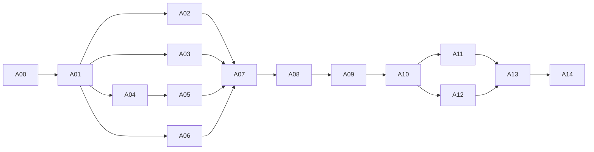

# Agent 实施计划

本轮交付目标是完整 CLI 分析能力、独立可发布 asc-core、薄 rasc CLI，以及可持续维护的必要 vendor。文档已准备好分派，但本次没有执行下列实施任务。工作起点为 lordcasser/main，业务基线 Rust e809c7b；完整 SHA 见 README。

## 三个 change 的关系

- complete-cli-analysis-contracts 负责用户可见行为、输入/查询/输出与验收。
- maintain-patched-analysis-backends 负责两个后端的必要补丁和维护边界；G02 的代码修复只有一个 owner，前一 change 只集成和验证。
- extract-publishable-core 负责机械迁移、嵌入运行和独立分发；不把业务修复混进目录搬迁。

先读 [接口契约](implementation/interfaces.md)、[验收矩阵](implementation/acceptance.md)、[依赖分发](changes/extract-publishable-core/dependencies.md)。基线 specs 是历史事实，change specs 是目标要求；这三份补充文档明确尚未实施的细节。若发现条目冲突，先由集成 owner 修正规格，不能让 agent 各选一套行为。

## 工作包与前置依赖

表中“前置”是必须已经通过并合入的工作包，不是软建议。

| 工作包 | 闭环 | 前置 | 主要 change |
|---|---|---|---|
| [A00](implementation/work-packages/A00.md) | 固定 fixture 与独立 oracle | — | `complete-cli-analysis-contracts` |
| [A01](implementation/work-packages/A01.md) | 冻结领域模型与查询构造 | A00 | `complete-cli-analysis-contracts` |
| [A02](implementation/work-packages/A02.md) | 补输入与 DEX 容器校验 | A01 | `complete-cli-analysis-contracts` |
| [A03](implementation/work-packages/A03.md) | 补齐查询扫描与完整身份 | A01 | `complete-cli-analysis-contracts` |
| [A04](implementation/work-packages/A04.md) | 建立 droidsaw 受控接口 | A01 | `maintain-patched-analysis-backends` |
| [A05](implementation/work-packages/A05.md) | 修复反编译语义 | A04 | `maintain-patched-analysis-backends` |
| [A06](implementation/work-packages/A06.md) | 修复 AXML 与 manifest 领域转换 | A01 | `maintain-patched-analysis-backends` |
| [A07](implementation/work-packages/A07.md) | 集成输入与结构化分析行为 | A02, A03, A05, A06 | `complete-cli-analysis-contracts` |
| [A08](implementation/work-packages/A08.md) | 完成 CLI 输出与错误闭环 | A07 | `complete-cli-analysis-contracts` |
| [A09](implementation/work-packages/A09.md) | 关闭行为补齐验收 | A08 | `complete-cli-analysis-contracts` |
| [A10](implementation/work-packages/A10.md) | 机械拆包与公开 API 冻结 | A09 | `extract-publishable-core` |
| [A11](implementation/work-packages/A11.md) | 实现资源生命周期和取消 | A10 | `extract-publishable-core` |
| [A12](implementation/work-packages/A12.md) | 隔离后端和嵌入副作用 | A10 | `extract-publishable-core` |
| [A13](implementation/work-packages/A13.md) | 完成派生包分发与质量工具 | A11, A12 | `extract-publishable-core` |
| [A14](implementation/work-packages/A14.md) | 独立验收最终架构与交付 | A13 | `extract-publishable-core` |



这是依赖图，不要求一次启动所有 agent。A02/A03/A04/A06 可并行，但 A04 与 A05 都改 droidsaw 同一批文件，必须串行。A07/A08/A09 分开集成、CLI 与审查。A10 是唯一全仓库迁移窗口，期间不得在旧路径另开实现；随后 A11/A12 可按 engine/input 与 backend/manifest 分工。槽位不足时调度任意 ready 且无文件冲突的包，不拆伪依赖抢跑。

## 集成和文件所有权

指定一个集成 owner 维护依赖就绪、共享接口、根 manifests/lock 和最终勾选状态；不需要新建一个管理 crate 或自动调度框架。实现 agent 只写自己任务卡列出的路径。共享工作区不能靠“不同函数”规避同文件冲突；同文件只能有一个写 owner，其他 agent 给出最小修改请求，由 owner 串行接线。

A01 冻结领域接口后再开放并行；A10 冻结 public Engine/OperationContext 后再开放 A11/A12。并行期间 model/query/error/lib、Cargo.toml/Cargo.lock 和根 README 由集成 owner 串行接收修改，不能各自更新 lock 再盲合并。fixture 同一 case 只允许原 owner 更新；公共 manifest 的新增 case 由 A00/集成 owner 统一登记，后续包可写自己的子目录。

推荐每个 agent 使用独立 worktree 和 `codex/asc-aXX` 分支，均从已集成前置的 commit 开始。branch/worktree 是后续实施建议，本次未创建。若多个 agent 共用当前目录，仍遵守相同路径锁；禁止 reset/覆盖其他 agent 的未提交工作。

每个包交接必须给可运行 commit/diff、任务内通过的测试和尚需下一阶段接线的条目。A02/A03 等允许准备新 low-level 入口，但旧入口只能作明确短期桥接，由 A07 删除；A10 后不得遗留两套业务实现。不能用空实现、todo!、全局 ignore 或跳过 mandatory cases 获得绿色。

## 分派提示词模板

把下面模板和对应 Axx 任务卡交给一个实施 agent，不必复制整段聊天记录：

```text
在 ASC 项目的 lordcasser/main 集成基线上实施工作包 Axx。
先读 openspec/execution-plan.md、openspec/implementation/interfaces.md、openspec/implementation/acceptance.md
以及 openspec/implementation/work-packages/Axx.md 和相关 change specs/design/tasks。
确认前置包已通过并合入，记录实际 base SHA；只修改任务卡允许的范围。
先理解周边调用再改代码；最小闭环，不考虑旧 API/输出兼容，不混入无关债务。
必要 vendor 补丁已经获准，按 maintain-patched-analysis-backends 记录来源和测试；
不用删功能换取无 vendor，不自动发布或给上游发消息。
接口/共享文件变动向集成 owner 提交具体变更请求，在协调后继续，不需为例行选择反复询问用户。
实现、验证并写 openspec/implementation/evidence/Axx.md，报告通过/失败/skip。
前置缺失或必过能力失败不能标完成；将准确阻断信息交接给集成 owner。
```

## 退出条件和任务状态

工作包经历 pending → ready → running → needs-fix/verified → integrated；这些是交接记录中的状态词，不需要实现状态服务。tasks.md 只在 owner 的实现与验收证据经过集成复核后勾选。所有任务目前保持未勾选。

A09 固定用户行为绿线；A14 必须复验最终架构、vendor 分发和所有能力，不能仅根据其他 agent 的结论盖章。正常支持用例返回 Incomplete 仍失败；坏输入正确失败是另一条验收。发现同一能力的新反例交回原 owner；新产品能力或大范围架构债务另开 change，不扩大当前包。

最终实施完成到 staged-verified：功能/三平台/MSRV/归档消费者/补丁测试/资源与性能证据均满足，所有 OpenSpec 要求有用例。三个 change 可在实现完成后按 vendor → 行为 → 架构顺序归档；已有 baseline requirement 的 MODIFIED delta 只能在通过后合并。实际 registry publish 是独立外部动作，未经届时授权不执行；正式 registry 未发布状态要保留在发行说明，不能声称已经 cargo add 可用。

“无盲区”在这里落实为已知要求、错误边界、资源、文件并发和发布条件都有 owner 与验收；不声称静态计划能证明没有未知 decompiler 缺陷。

## 2026-10-15 增量工作包

[A20](implementation/work-packages/A20.md) 在 Rust d78123f 基线上吸收上游直接类继承/接口
反查能力，规格为 add-direct-class-relations；其逐边结果独立于指令引用，沿用 core 与薄
CLI 两层。实施、独立 review 与当前云端证据见 [A20 evidence](implementation/evidence/A20.md)。
A16–A18 的未完成环境矩阵不在本包关闭范围内。
